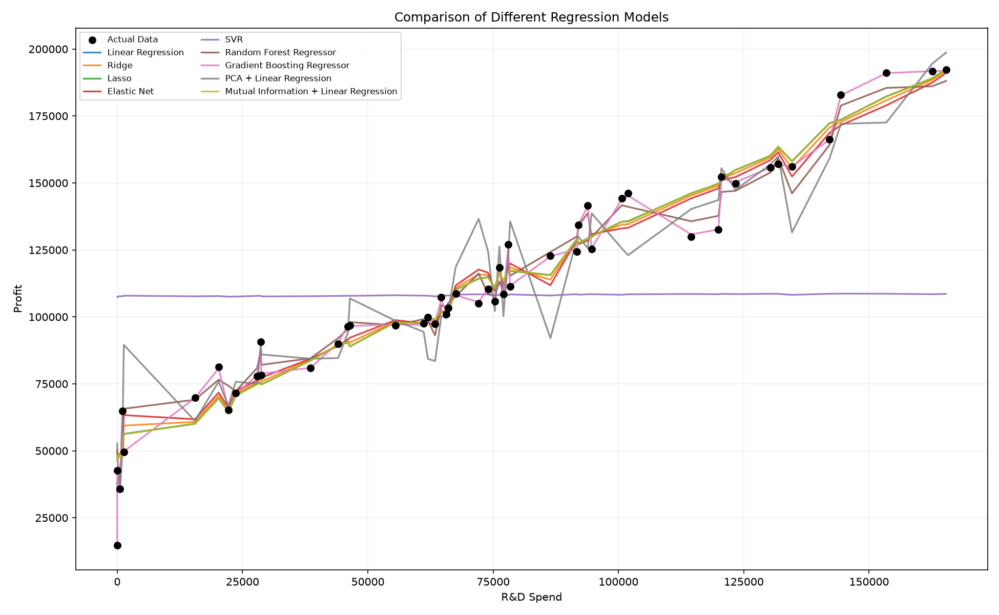
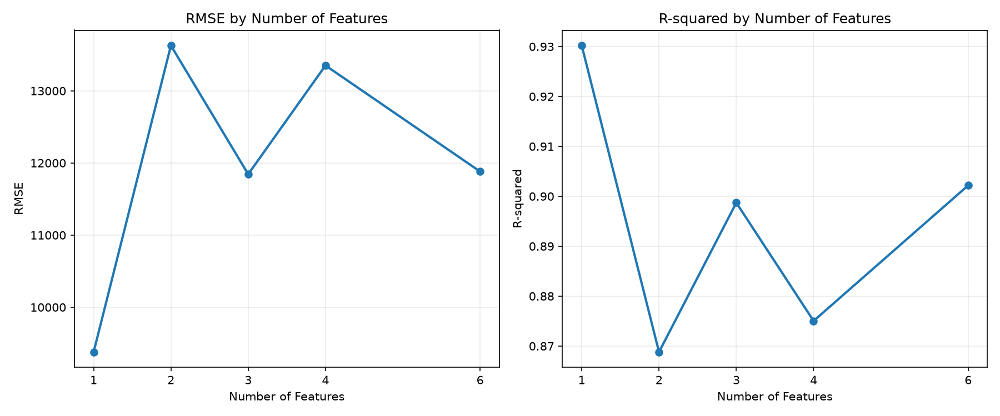

# 50 Startups Multiple Linear Regression

This university assignment applies the CRISP-DM process: business understanding, data understanding, data preparation, modeling, evaluation, and deployment.

## Live Website

[View the regression analysis on Vercel](https://1014-ruddy.vercel.app)

## Dataset

The `50_Startups.csv` dataset contains information about 50 startups, including R&D Spend, Administration, Marketing Spend, and State. The target variable is **Profit**, which the regression models predict.

## Model Comparison

## Feature Selection

## Results

- Best model: **Random Forest Regressor**
- Test RMSE: **8058.99**
- Test R-squared: **0.9198**
- Feature selection identified **R&D Spend** as the strongest individual feature.
